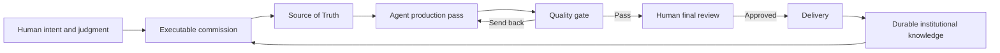

# Parliament of MarkDown Studios

**One Truth, Infinite Expressions.**

Parliament is a documentation-first operating system for human-directed, multi-agent work. It gives people and AI agents a shared constitution, explicit authority boundaries, one Source of Truth per governed scope, progressive approval states, and a recovery path when context is lost.

This repository is a sanitized public derivative of the private system I designed and use inside **MarkDown Studios**, the internal AI production studio of **Serendipity Inc.** It demonstrates how I translate creative and business intent into inspectable agent workflows without surrendering final human judgment.

## The problem

Multi-agent work becomes unreliable when instructions live only in chat, every model receives a different fragment of context, polished output is mistaken for correct output, and nobody can identify which document is authoritative.

Parliament addresses that failure with five controls:

1. **Human authority remains explicit.** Agents may research, draft, inspect, and route work; the human retains consequential judgment and final approval.
2. **One governed scope has one Source of Truth.** Derivatives follow it and drift is repaired at the source.
3. **Work advances through approval states.** Rough Cut, Fine Cut, Locked Cut, and Online reduce different kinds of uncertainty.
4. **The Human-AI Sandwich defines production.** A complete starting state and an inspectable end state must exist before middle production begins.
5. **Every completed task compounds the institution.** Decisions, methods, failures, and safeguards become durable Markdown assets.

## System map



## What this project demonstrates

- information architecture for cold-start agent recovery;
- prompt and commission design;
- human-in-the-loop approval boundaries;
- multi-agent routing and quality control;
- hallucination and drift control through explicit SOT declarations;
- semantic versioning and preserved history;
- Obsidian-compatible knowledge-graph design;
- reusable templates for future workflows.

## Start here

1. [Project overview](docs/00_START_HERE.md)
2. [Architecture](docs/01_ARCHITECTURE.md)
3. [Constitution](docs/02_GOVERNANCE/01_CONSTITUTION.md)
4. [Single Source of Truth](docs/03_OPERATING_SYSTEM/01_SINGLE_SOURCE_OF_TRUTH.md)
5. [Human-AI Sandwich](docs/03_OPERATING_SYSTEM/02_HUMAN_AI_SANDWICH.md)
6. [Production Wheel](docs/03_OPERATING_SYSTEM/03_PRODUCTION_WHEEL.md)
7. [Four-Pass Approval Workflow](docs/03_OPERATING_SYSTEM/04_FOUR_PASS_APPROVAL.md)
8. [Obsidian vault guide](docs/05_OBSIDIAN_VAULT.md)

## Repository anatomy

```text
parliament-of-markdown-studios/
├── README.md
├── docs/
│   ├── 00_START_HERE.md
│   ├── 01_ARCHITECTURE.md
│   ├── 02_GOVERNANCE/
│   ├── 03_OPERATING_SYSTEM/
│   ├── 04_TEMPLATES/
│   └── 05_OBSIDIAN_VAULT.md
├── .obsidian/
└── scripts/validate_public_repo.sh
```

## Public-scope boundary

This repository explains the architecture and reusable operating methods. It intentionally excludes client material, private agent commissions, internal command registers, credentials, personal filesystem paths, live production records, and institutional history that is not required to understand the system.

The private Parliament remains the institutional Source of Truth. GitHub is a portfolio expression, not the governing chamber.

## Authorship

Designed and directed by **Daniel Chiacos**, Founder and Creative Director of Serendipity Inc. and creator of MarkDown Studios.

## License

MIT. See [LICENSE](LICENSE).

