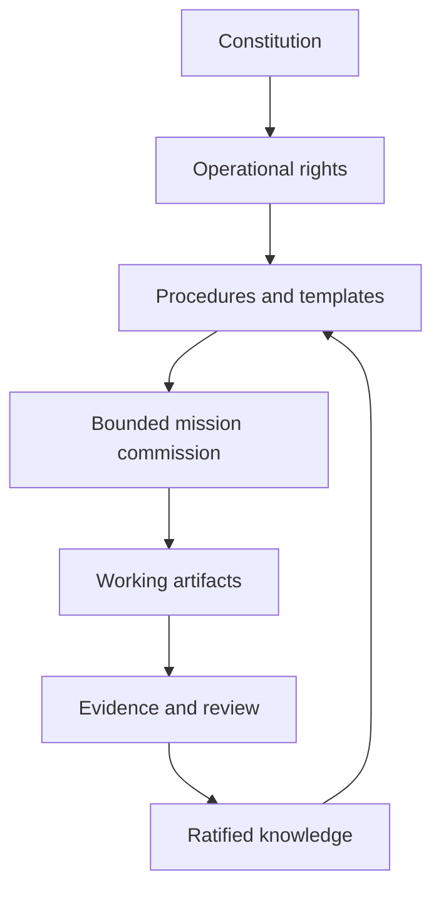

# Parliament Architecture

## Three layers

| Layer | Function | Typical artifacts |
| --- | --- | --- |
| Governance | Defines purpose, rights, authority, and boundaries | Constitution, rights, ratification law |
| Operations | Defines repeatable production behavior | SOT controls, Sandwich, Production Wheel, approval workflow |
| Institutional memory | Preserves reusable knowledge and history | SOPs, cases, decisions, versioned records |

## Authority flow



## File-state model

Parliament is governed by states, not merely folders. Folders make those states visible.

| State | Meaning |
| --- | --- |
| Capture | An idea or observation has been preserved |
| Candidate | A method is being tested |
| HOLD | Affected work is stopped while a material dependency remains unresolved |
| Ratified | Human authority has granted institutional force |
| Production | A bounded commission is executing |
| Superseded | A newer source controls the scope |
| Graveyard | Inactive history is preserved for provenance |
| Reserved shell | A complete template awaits a distinct subject but contains no law or execution authority |

## Cold-start recovery

A cold reader follows one predictable route:

```text
README
  -> local terms
  -> SOT declaration
  -> active governing procedure
  -> guides and templates
  -> evidence
  -> Graveyard only for provenance
```

This prevents the reader from treating the first plausible-looking document as law.

The architecture also provides a governed route from [decision dockets](02_GOVERNANCE/03_DECISION_DOCKETS.md) through the [incident-to-SOP lifecycle](03_OPERATING_SYSTEM/06_INCIDENT_TO_SOP_LIFECYCLE.md), with [cold-reader context compression](03_OPERATING_SYSTEM/07_COLD_READER_CONTEXT_COMPRESSION.md) at each operational surface.

## Hub-and-spoke custody

Ideas often surface while another task is already moving. Parliament uses a hub to preserve the germination without forcing immediate final classification. Later review routes mature ideas to their correct spokes.

> Capture now. Classify enough to recover. Route deeply when the idea earns it.
