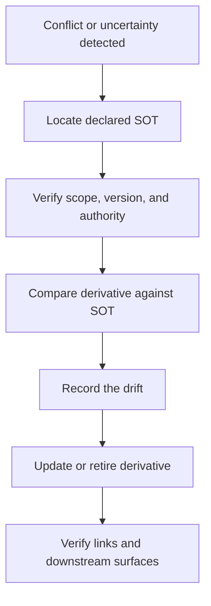

# Single Source of Truth and Drift Control

## Law

One governed scope has one Source of Truth. Everything else is a derivative.

When two active-looking documents disagree, the system must not average them, select the newest-looking prose, or invent a compromise. It returns to the declared SOT, identifies the drift, and repairs the derivative.

## Required declaration

Every governed department answers:

1. What exact scope is controlled?
2. What is the one SOT?
3. Where is it and what is its version or status?
4. Who may change it?
5. Which artifacts are derivatives?
6. What wins in a conflict?
7. How does a cold reader recover?

## Recovery procedure

## Hallucination-control effect

An agent can still make a mistake. The architecture reduces how far the mistake travels because the recovery route is explicit, the authority is inspectable, and derivatives do not become independent law merely by being repeated.

