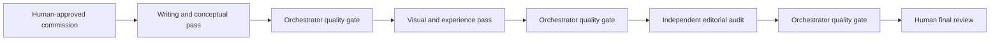

# Production Wheel

The Production Wheel is a controlled multi-agent handoff. Every specialist receives the original approved commission, accumulated evidence, and a bounded lane.

## Reference route

The named models may change. The control structure remains:

- original commission accompanies every handoff;
- each specialist has one defined lane;
- the orchestrator checks every return before routing it onward;
- correctable defects are returned to the responsible lane;
- genuine authority or taste decisions are escalated to the human;
- publication is never implied by production completion.

## Three-way verdict

Every return receives one decision:

1. **PASS:** acceptance gate cleared; route forward.
2. **SEND BACK:** correctable in-scope defect; name the defect and re-entry test.
3. **ESCALATE:** genuine SOT change, new authority, material risk, or irreducible human judgment.

## Why the wheel works

It combines specialization with continuity. Specialists do not manage the project or reinterpret authority independently. The orchestrator carries the SOT, state, evidence, and quality bar through the full pass.

