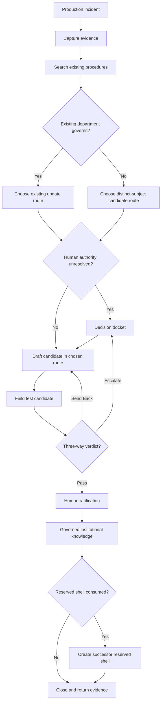

# Incident-to-SOP Lifecycle

A production system compounds when a real ambiguity can become reusable operating intelligence without interrupting delivery or allowing an agent to invent law.

## Terms used here

- **SOP:** Standard Operating Procedure, a governed definition of repeatable work.
- **SOT:** Source of Truth, the single controlling source for one governed scope.
- **Docket:** A bounded decision surface for connected questions requiring human judgment.
- **Reserved shell:** A complete but non-authoritative department template held ready for the next distinct procedural subject.

## The flywheel

## Operating sequence

1. Preserve what happened, why it matters, the evidence, and the limits without derailing the active task.
2. Search active procedures, related terms, candidate notes, and preserved history before creating a new subject.
3. Update an existing department when it already governs the recurring method.
4. Use a decision docket when connected questions require human judgment or block dependent routes.
5. Create a new SOP department only when evidence supports a distinct recurring procedural subject.
6. Build candidate material with explicit status; polished prose, repetition, folder placement, or agent agreement does not create authority.
7. Test the candidate against field evidence and return one verdict: Pass, Send Back, or Escalate.
8. Human ratification is the transition from candidate material to governing procedure.
9. Preserve superseded material for provenance.
10. If a reserved shell was consumed, create the next complete reserved shell before the lifecycle closes.

## Department anatomy

A candidate Standard Operating Procedure (SOP) department contains:

- one populated `00. Source of Truth (SOT) Declaration`;
- at least three semantically named content categories derived from real material;
- one local `99. SOP Graveyard`;
- exactly one root ReadMe that explains the cold-reader route;
- explicit candidate and ratification status; and
- a next reserved shell when a prior shell was consumed.

A Best Practices category is created only when a reusable application method actually exists. Empty ceremonial categories do not prove institutional maturity.

## Reserved-shell rule

A reserved shell has no subject, procedural Source of Truth, governing law, or execution authority. Its job is to preserve institutional runway. When a distinct subject legitimately consumes it, the system creates the next complete shell before closure.

## Authority boundary

An agent may preserve evidence, search the estate, recommend placement, draft a candidate, and verify structure. The declared human authority defines or approves the distinct subject and alone grants governing force.

This public file explains the lifecycle without reproducing a private incident, docket, commission, or SOP. Continue with [Cold-Reader Context Compression](07_COLD_READER_CONTEXT_COMPRESSION.md) or return to [Start Here](../00_START_HERE.md).
